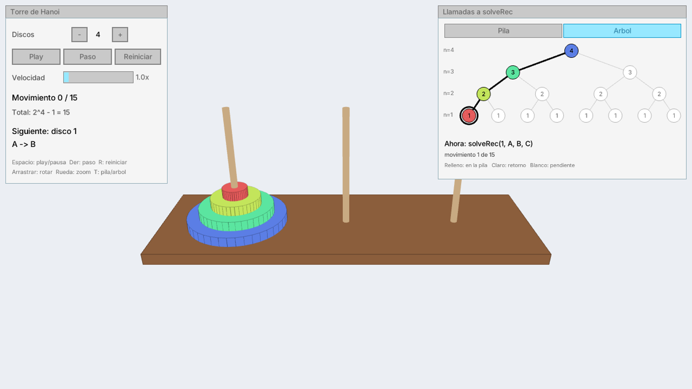
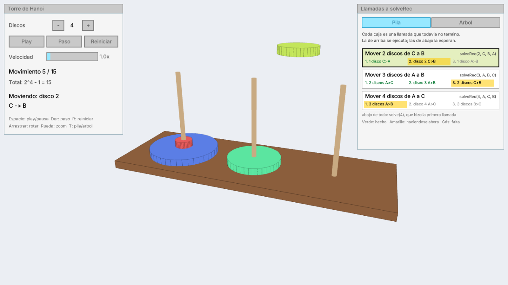
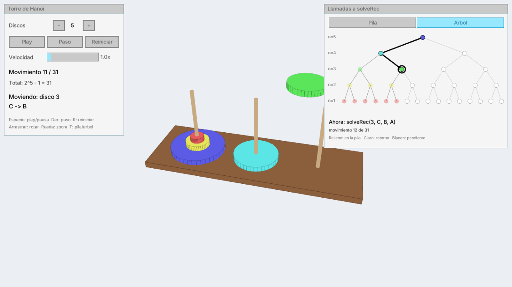
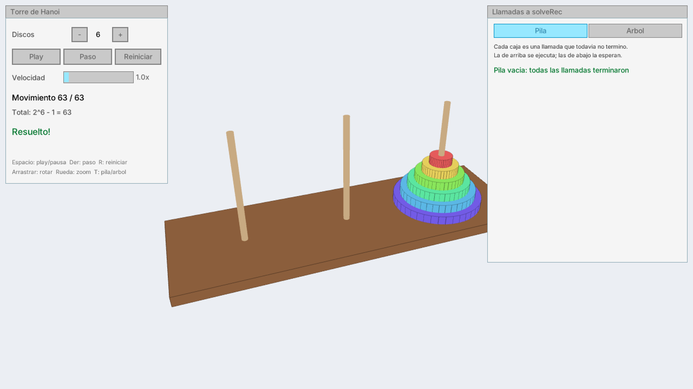

# Torre de Hanoi

Visualizador 3D de la Torre de Hanoi en C++20 con [raylib](https://www.raylib.com/) y [raygui](https://github.com/raysan5/raygui). Resuelve el problema de forma recursiva y anima cada movimiento, mostrando al mismo tiempo la **pila de llamadas** y el **árbol de llamadas** de la función recursiva `solveRec`.



## Capturas

| Pila de llamadas durante un movimiento | Árbol de llamadas |
|---|---|
|  |  |

| Torre resuelta |
|---|
|  |

## Funcionalidades

- Escena 3D con cámara orbital (rotar con el mouse, zoom con la rueda).
- De 1 a 10 discos; el total de movimientos se muestra como `2^n - 1`.
- Reproducción automática, paso a paso y reinicio, con velocidad ajustable (0.25x a 10x).
- Panel **Pila**: las llamadas a `solveRec` que siguen activas, con los 3 pasos de cada una (hecho / en curso / pendiente).
- Panel **Árbol**: el árbol completo de llamadas recursivas, marcando cuáles ya retornaron, cuáles están en la pila y cuál hace el movimiento actual. Al pasar el mouse por un nodo se ve su llamada.

## Controles

| Acción | Tecla / mouse |
|---|---|
| Play / pausa | `Espacio` o botón **Play** |
| Siguiente movimiento | `→` o botón **Paso** |
| Reiniciar | `R` o botón **Reiniciar** |
| Cambiar entre pila y árbol | `T` o pestañas **Pila / Arbol** |
| Rotar la cámara | Arrastrar con el botón izquierdo |
| Zoom | Rueda del mouse |

## Algoritmo

```cpp
void HanoiSolver::solveRec(int n, int from, int to, int aux) {
    if (n > 0) {
        solveRec(n - 1, from, aux, to);   // 1. quitar la sub-torre de encima
        moves[moveCount++] = {n, from, to}; // 2. mover el disco más grande
        solveRec(n - 1, aux, to, from);   // 3. reconstruir la sub-torre encima
    }
}
```

`HanoiSolver` calcula todos los movimientos de una vez y la interfaz los anima uno por uno. La pila y el árbol se reconstruyen a partir del número de movimiento (`CallStack.cpp`), sin volver a ejecutar la recursión.

## Compilar y ejecutar

Requisitos: CMake 3.24 o superior y un compilador con C++20. raylib 5.5 y raygui 4.0 se descargan automáticamente con `FetchContent` la primera vez que se configura el proyecto, así que no hay que instalar nada a mano.

```bash
cmake -S . -B build -DCMAKE_BUILD_TYPE=Release
cmake --build build
./build/torre_de_hanoi
```

En CLion basta con abrir la carpeta y ejecutar el target `torre_de_hanoi`. La carpeta `assets/` se copia junto al ejecutable después de cada compilación.

## Estructura

```
src/
├── core/                 lógica, sin dependencias de gráficos
│   ├── Config.h          límites (MAX_DISKS = 10)
│   ├── Move.h            un movimiento: disco, torre origen y destino
│   └── HanoiSolver.*     solución recursiva
└── app/                  interfaz con raylib / raygui
    ├── main.cpp          ventana, escena 3D, animación, panel de controles
    ├── TowerState.*      estado de las 3 torres (cada una es una pila)
    ├── CallStack.*       reconstruye la pila de llamadas de solveRec
    ├── CallsPanel.*      panel de pila / árbol de llamadas
    └── UiCommon.*        fuente, colores y helpers de texto
assets/fonts/             fuente Inter (licencia OFL)
```

## Licencia

[MIT](LICENSE)
